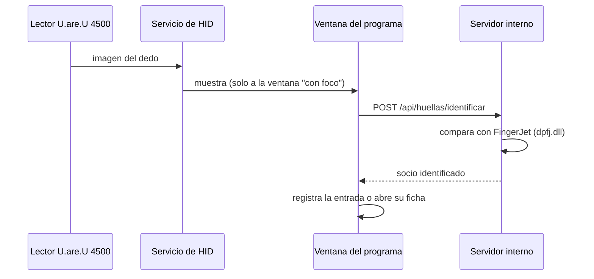
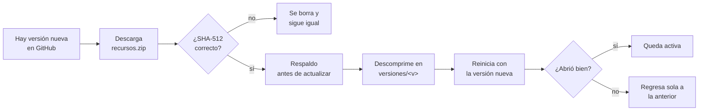
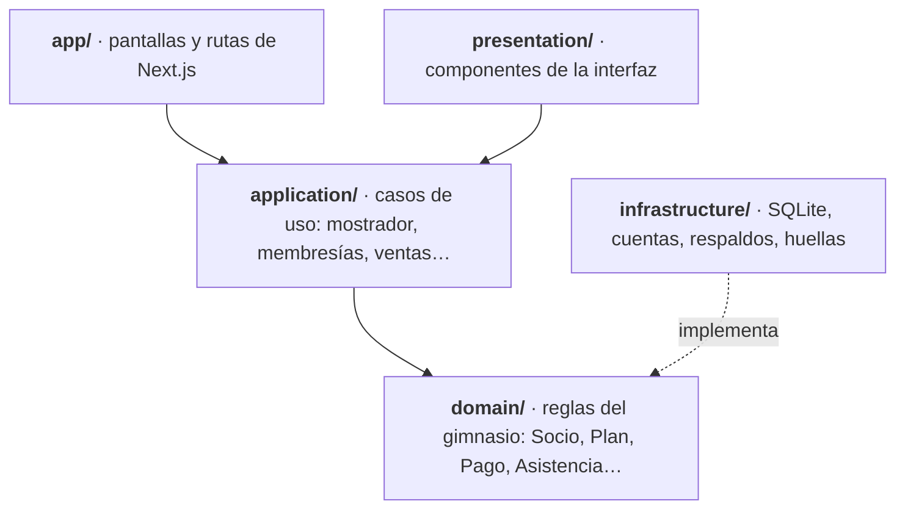

<p align="center">
  
</p>

<h1 align="center">Olimpo GYM</h1>

<p align="center">
  <b>El sistema del mostrador del gimnasio.</b><br>
  Entradas con huella digital, membresías, ventas e inventario en un programa de Windows<br>
  que guarda todo en la propia computadora: sin servidores, sin internet y sin mensualidades.
</p>

<p align="center">
  <a href="https://github.com/Sottoo/OlympoGYM/releases/latest"></a>
  
  
  
  
</p>

<p align="center">
  <a href="#qué-hace">Qué hace</a> ·
  <a href="#lector-de-huellas">Huellas</a> ·
  <a href="#respaldos">Respaldos</a> ·
  <a href="#actualizaciones-automáticas">Actualizaciones</a> ·
  <a href="#para-desarrollar">Desarrollo</a>
</p>

---

## Qué hace

| | |
| --- | --- |
| **Mostrador** | El socio pone el dedo o se le busca por nombre, celular o número. Si puede pasar, su entrada se registra sola; si no, aparece su ficha para decidir. `F2` lleva al mostrador desde cualquier pantalla. |
| **Socios y membresías** | Altas con foto, cobro de planes en efectivo o transferencia, renovaciones sin perder días y bajas que conservan todo el historial. |
| **Asistencias** | Quién entró cada día y a qué hora. El mostrador recuerda a los socios que suelen llegar a esta hora y hoy aún no vienen. |
| **Ventas e inventario** | Venta de mostrador, entradas de mercancía y conteos rápidos. El stock solo cambia con movimientos y nunca queda negativo. |
| **Mantenimiento** | Equipos del gimnasio, reportes de fallas, servicios y pagos pendientes. |
| **Métricas** | Entradas por día, horas pico, ingresos por mes, altas y bajas, rachas más largas, ingresos contra mantenimiento y lo más vendido. |
| **Bitácora** | Quién cambió qué y cuándo, con el antes y el después. La escribe la propia base de datos y nadie puede editarla ni borrarla. |

**Cuatro promesas del programa**

- **Funciona sin internet.** La base de datos es un archivo SQLite dentro de la computadora.
- **No pierde información.** Respaldo diario automático, copia a Google Drive o USB, y otro respaldo antes de cada actualización.
- **Se actualiza solo.** Las versiones nuevas llegan desde GitHub sin reinstalar, y si una falla al abrir regresa sola a la anterior.
- **Se entiende a la primera.** Diseño «Porcelana»: claro y sereno, una sola tipografía (Instrument Sans) y el vino de la marca como acento. Las reglas están al inicio de `src/app/globals.css`.

---

## Lector de huellas

El socio registra su huella una vez (4 toques del mismo dedo, con su consentimiento) y desde entonces entra con solo poner el dedo. Es opcional: sin lector, el mostrador sigue funcionando por nombre o número.



- **Lector:** HID DigitalPersona U.are.U 4500 (USB).
- **En la computadora del mostrador** se instala el cliente gratuito [HID Authentication Device Client](https://crossmatch.hid.gl/lite-client/) (antes *DigitalPersona Lite Client*). Trae el driver, el servicio que atiende al lector y el motor de comparación `dpfj.dll`. Su licencia no permite incluirlo en nuestro instalador, así que si falta, el mostrador ofrece **Instalar programa del lector**: lo descarga de HID, revisa que esté firmado por HID Global y lo abre (`olimpo:instalar-lector` en `electron/main.cjs`).
- **Privacidad:** solo se guarda la plantilla de la huella (tabla `huellas`), nunca la imagen. Es un dato personal sensible y el socio debe aceptar su uso.
- **Código:** conexión con el lector en `src/presentation/components/huellas/lectorDeHuellas.ts` (scripts MIT de HID en `public/vendor/digitalpersona/`) y comparación con `koffi` en `src/infrastructure/huellas/FingerJet.ts`.

> [!IMPORTANT]
> **El servicio de HID solo entrega huellas a la ventana que dice tener el foco.** En Electron, después de un `window.confirm()`, `document.hasFocus()` se queda en `false`: el lector se ve encendido y «listo», pero no responde. Por eso la conexión siempre avisa «con foco» y el programa no usa `window.confirm` ni `alert`.

<details>
<summary><b>Más detalles del lector</b></summary>

- **Una sola conexión por ventana.** Las pantallas solo se suscriben; la última abierta recibe las huellas.
- **Si el servicio de HID se reinicia** (por ejemplo, al despertar la computadora), abre otro puerto con otra clave. Los scripts de HID guardan los anteriores, así que cada reconexión los borra y los vuelve a pedir.
- Mientras el servicio no conteste, el programa reintenta cada 5 s. **Reiniciar** hace una reconexión a la vez, aunque se apriete varias veces.
- **Con Smart App Control activado**, el instalador de HID falla en el paso `StopAgent` (usa una DLL sin firma). Se puede instalar el `.msi` de HID con un *transform* que quita solo ese paso; todo lo que queda instalado está firmado.

</details>

---

## Respaldos

En la sección **Respaldos** del programa:

- **Cada día**, al abrir, se guarda un respaldo `.zip` con la base y las fotos. Se conservan los últimos 30.
- **Carpeta extra:** se elige una carpeta de Google Drive para escritorio, OneDrive o una USB, y cada respaldo se copia también ahí. Es lo que protege la información si la computadora se descompone. Mientras no se configure, la pantalla *Hoy* lo recuerda en *Pendientes del turno*.
- **Crear respaldo ahora**, **Descargar** y **Enviar por WhatsApp** (abre la carpeta con el archivo seleccionado y WhatsApp; se arrastra al chat, porque WhatsApp no permite adjuntar archivos de forma automática).
- **Restaurar** reemplaza toda la información por la de un respaldo, por ejemplo en una computadora nueva. Antes guarda una copia de lo actual.

| Qué | Dónde (programa instalado) |
| --- | --- |
| Base de datos y fotos | `%APPDATA%\Olimpo GYM\datos` (`olimpo.db` y `fotos\`) |
| Respaldos | `Documentos\Olimpo GYM\Respaldos` |
| Registro del servidor interno | `%APPDATA%\Olimpo GYM\servidor.log` |
| Registro de actualizaciones | `%APPDATA%\Olimpo GYM\actualizaciones.log` |

**Cuentas:** la primera vez se crea la cuenta del administrador. Las contraseñas se guardan cifradas (scrypt) y la sesión es una cookie firmada. El **código de recuperación** se muestra una sola vez; con él se restablece la contraseña en *¿Olvidaste tu contraseña?* y después se entrega uno nuevo.

---

## Actualizaciones automáticas

Desde la 1.0.0-beta.33 las actualizaciones **no usan instalador**: Windows bloqueaba el instalador sin firma cuando lo lanzaba el programa. Cada versión publica también `recursos-<versión>.zip` (unos 12 MB con Electron y el servidor compilado, ver `scripts/paquete-de-codigo.mjs`). El programa revisa al abrir y cada 5 minutos, o al tocar **Buscar actualización** en *Mi cuenta*.



- `electron/arranque.cjs` es el punto de entrada y nunca cambia: elige con qué código arrancar según `versiones/actual.json` (ver `electron/versiones.cjs`).
- Si una versión nueva necesita otro Electron, se usa el instalador completo.
- **Nunca se actualiza sin respaldo.** Lo hace el servidor interno (`/api/interno/respaldo-previo`), que solo acepta la llave aleatoria que el programa le da al abrir.
- Sin internet o si algo falla, el programa sigue igual y lo reintenta después.

<details>
<summary><b>Cómo se actualizaba antes (1.0.0-beta.26 a .32, con instalador)</b></summary>

1. Al abrir (y cada 6 horas) leía `actualizacion.json` de la última Release de GitHub.
2. Si la versión era más nueva, descargaba el instalador por detrás y revisaba su tamaño y huella SHA-512.
3. En el riel aparecía **Versión nueva lista** y salía una notificación de Windows. Se instalaba al hacer clic o, en silencio, al cerrar el programa, siempre después de guardar un `...-antes-de-actualizar.zip` en `Documentos\Olimpo GYM\Respaldos` y comprobar que trajera la base completa.

Mientras el instalador trabajaba se veía una ventanita «Actualizando Olimpo GYM a la versión X…», y si alguien abría el programa a media instalación, avisaba y no se abría.

</details>

---

## Para desarrollar

Necesitas [Node.js](https://nodejs.org) 22.13 o superior (trae SQLite integrado).

```bash
git clone https://github.com/Sottoo/OlympoGYM.git
cd OlympoGYM
npm install
npm run dev
```

Abre <http://localhost:3000>. La primera vez pide **crear la cuenta del administrador** y entrega un **código de recuperación**. Al desarrollar, la base y los respaldos quedan en `.datos/` (fuera de git). Para verlo como programa de escritorio, con `npm run dev` corriendo en otra terminal: `npm run escritorio:dev`.

| Comando | Qué hace |
| --- | --- |
| `npm run dev` | Servidor de desarrollo en localhost:3000 |
| `npm run typecheck` | Revisa errores de TypeScript |
| `npm run escritorio:dev` | Abre la ventana de escritorio sobre `npm run dev` |
| `npm run build:escritorio` | Compila la versión de escritorio |
| `npm run escritorio` | Abre la ventana con la versión compilada |
| `npm run instalador` | Genera el instalador `.exe` en `dist-escritorio/` |
| `npm run instalador:docker` | Igual, dentro de Docker (cuando Smart App Control bloquea el anterior) |
| `npm run publicar` | Publica la versión en GitHub para que el gimnasio se actualice solo |

### Arquitectura

El código está en capas y **las de adentro no conocen a las de afuera**: el dominio no sabe que existen SQLite ni Next.js. Gracias a eso se pasó de Supabase (en la nube) a SQLite (local) sin tocar las reglas del negocio ni las pantallas.



<details>
<summary><b>Carpetas</b></summary>

```
src/
├── domain/            Reglas del negocio
│   ├── entities/         Socio, Plan, Suscripcion, Pago, Producto, Venta, Huella,
│   │                     MovimientoInventario, Asistencia, RegistroBitacora…
│   ├── repositories/     Contratos: "necesito guardar socios" (sin decir cómo)
│   ├── services/         Reloj, AlmacenFotos, MotorDeHuellas
│   └── shared/           Fechas, permisos y errores de negocio
├── application/       Casos de uso: mostrador, socios, membresías, ventas,
│                      inventario, mantenimiento, huellas, métricas, bitácora…
├── infrastructure/    Herramientas concretas
│   ├── sqlite/           Estructura, migraciones, conexión y repositorios
│   ├── auth/             Cuentas, contraseñas cifradas y sesión
│   ├── respaldo/         Respaldos .zip (crear, copiar, restaurar)
│   ├── huellas/          FingerJet (dpfj.dll) mediante koffi
│   └── contenedor.ts     Aquí se conecta todo
├── presentation/      Componentes y ayudas de la interfaz
├── shared/            Formato de fechas, dinero y teléfonos
└── app/               Pantallas y rutas (login, panel, api…)
electron/              Ventana, arranque por versiones, actualizador y puente con Windows
scripts/               Instalador, paquete de código y publicación
```

</details>

<details>
<summary><b>Reglas de negocio</b></summary>

- La membresía es válida **hasta el último día inclusive** (la mensual del 1 de septiembre vence el 30).
- Los planes mensuales respetan el fin de mes (31 de enero + 1 mes = 28 de febrero).
- **Si el socio renueva antes de vencer, no pierde días:** el nuevo periodo empieza al terminar el actual.
- «Por vencer» = le quedan 7 días o menos.
- Se cobra **en efectivo o por transferencia**.
- Solo se registran **entradas**, no salidas.
- Sin membresía vigente, el socio solo pasa **como excepción con motivo**. Una entrada se puede deshacer durante 10 minutos, y dos registros del mismo socio en menos de 2 horas se bloquean.
- Todo socio necesita celular. Fecha de nacimiento y foto son opcionales; la foto se reduce a unos 50 KB.
- **Dar de baja no borra nada:** el socio conserva su historial y se puede reactivar.
- **El stock solo cambia con movimientos** y nunca queda negativo. Una venta se guarda completa o no se guarda.
- La bitácora la escriben *triggers* de la base, que rechaza cualquier intento de editarla o borrarla.

</details>

### Publicar una versión

```bash
# 1. Sube "version" en package.json (por ejemplo 1.0.0-beta.40)
npm run instalador:docker        # termina con la línea "Listo: …exe"
npm run publicar -- "Qué cambió en esta versión"
```

Necesita `gh` con sesión iniciada (`winget install --id GitHub.cli` y `gh auth login`) y, para el instalador en Docker, Docker Desktop encendido. Una versión publicada no se reemplaza: para corregirla se publica otra con número mayor.

> [!WARNING]
> El instalador no está firmado con un certificado, así que la seguridad de las actualizaciones depende de la cuenta de GitHub: mantenla con verificación en dos pasos. La primera vez, Windows muestra «Windows protegió su PC»: se instala con **Más información → Ejecutar de todos modos**. Las versiones nuevas se instalan encima sin tocar los datos, y si la estructura de la base cambió, el programa la actualiza sola al abrir.

---

## Siguientes pasos

Lo que queda fuera de esta versión y se puede cotizar aparte:

- [ ] Lector de código de barras con credenciales impresas
- [ ] Cancelar una venta capturada por error (hoy se corrige con un ajuste de stock)
- [ ] Recordatorios de vencimiento por WhatsApp (manuales o automáticos con la API de WhatsApp Business, con costo por mensaje)
- [ ] Registro de salida, para saber quién está entrenando en este momento
- [ ] Cobro con tarjeta
- [ ] Varias cuentas de personal con permisos distintos
- [ ] Pruebas automáticas de los casos de uso (el `Reloj` inyectable facilita probar cualquier fecha)

<br>

<p align="center">
  <sub>Hecho a la medida para <b>Olimpo GYM</b> · Next.js, TypeScript, Tailwind CSS y Electron</sub>
</p>
